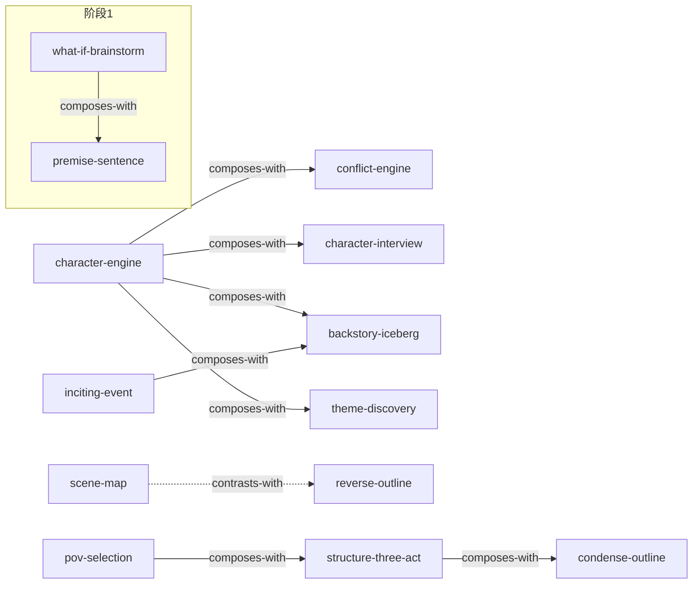

# 《小说的骨架：好提纲成就好故事》 — Skill Index

> 本书由 cangjie-skill 蒸馏，共产出 **16** 个 skills（15 原子工序 + 1 总编排）。
> 处理时间: 2026-08-26 · 源文本 90071 字 · 候选池 212 条（框架 32 + 原则 69 + 案例 49 + 反例 44 + 术语 18）

## 关于这本书

- **作者**: [美]凯蒂·维兰德 (K.M. Weiland)，邢玮 译
- **原书**: Outlining Your Novel (2011)；中译 2018 后浪
- **一句话主旨**: 好提纲不是束缚创造力的牢笼，而是一张让你动笔前看清全局、避开死胡同、把"探索乐趣"提前释放的小说航海图——经过训练人人能掌握。
- **整书理解**: [BOOK_OVERVIEW.md](./BOOK_OVERVIEW.md)
- **精华长文**（不读全书看这篇）: [DIGEST.md](./DIGEST.md)
- **术语词典**: [GLOSSARY.md](./GLOSSARY.md)

> **使用调子 ★**: 本套 skill **纯蒸馏**维兰德原书方法论（西方传统出版小说家视角）。每个 skill 的 B 段诚实标注"文学性 vs 网文"张力，但**不内置网文适配**。网文场景的翻译由项目现有 `story-*` 体系承接，两者互补不重叠。

---

## Skill 列表（按流水线阶段分组）

### 🎯 总编排（入口）
- [`novel-outline-pipeline`](./novel-outline-pipeline/SKILL.md) — 把零散人物经历/场景/点子，按 8 阶段串成一条流水线，最终输出完整提纲。**用户入口，先说这个。**

### 阶段 0 · 摆正心态
- [`outline-mindset`](./outline-mindset/SKILL.md) — 破除错误认知，确立"提纲是指南非铁律"。

### 阶段 1 · 定义小说
- [`what-if-brainstorm`](./what-if-brainstorm/SKILL.md) — "如果"问句疯狂发散可能性。
- [`premise-sentence`](./premise-sentence/SKILL.md) — 一句话锁定人物+冲突+情节。

### 阶段 2 · 盘点场景
- [`scene-map`](./scene-map/SKILL.md) — 列已知场景、标漏洞、连点成画。

### 阶段 3 · 核心元素
- [`character-engine`](./character-engine/SKILL.md) — 动机-愿望-目标链。
- [`conflict-engine`](./conflict-engine/SKILL.md) — 在人物与目标之间加障碍。
- [`theme-discovery`](./theme-discovery/SKILL.md) — 用人物轨迹显化主题（不说教）。

### 阶段 4 · 人物深挖
- [`inciting-event`](./inciting-event/SKILL.md) — 那扇"回不去了"的门。
- [`backstory-iceberg`](./backstory-iceberg/SKILL.md) — 挖水下的八分之七。
- [`character-interview`](./character-interview/SKILL.md) — 100+ 问 + 自由采访。

### 阶段 5 · 背景世界
- [`setting-worldbuild`](./setting-worldbuild/SKILL.md) — 背景四问 + 世界建构。

### 阶段 6 · 搭结构
- [`pov-selection`](./pov-selection/SKILL.md) — 视角选择三问。
- [`structure-three-act`](./structure-three-act/SKILL.md) — 开头-中间-结尾 + 三大元素 + 首尾呼应。
- [`reverse-outline`](./reverse-outline/SKILL.md) — 卡住时从结局倒着写。

### 阶段 7 · 精简成稿
- [`condense-outline`](./condense-outline/SKILL.md) — 扩展版→精简版 + 章节结尾 11 式 + 多米诺删减。

---

## 引用图



图例: `-->` composes-with / depends-on · `-.->` contrasts-with

依赖方向（depends-on）: premise-sentence ← what-if-brainstorm；conflict-engine ← character-engine；backstory-iceberg ← inciting-event；condense-outline ← structure-three-act。

---

## 推荐学习顺序（从依赖图叶子向上）

1. **outline-mindset** — 最基础，无前置（先摆正心态）。
2. **what-if-brainstorm** → **premise-sentence** — 先发散后收敛。
3. **scene-map** — 盘点已知场景（与 reverse-outline 互补）。
4. **character-engine** — 人物驱动力（后续 conflict/interview/backstory/theme 都依赖它）。
5. **conflict-engine** / **theme-discovery** / **inciting-event** / **backstory-iceberg** / **character-interview** — 基于人物引擎。
6. **setting-worldbuild** / **pov-selection** / **structure-three-act** — 背景与结构。
7. **reverse-outline** — 卡住时救急。
8. **condense-outline** — 最后精简成稿。
9. **novel-outline-pipeline** — 总编排，把上面全部串起来用（其实它是入口，可以直接从它开始）。

---

## 安装使用

本目录是构建产物，宿主不会从这里加载 skill。要让 agent 真正调用，把 skill 目录复制到宿主的 skills 目录：

```bash
# 用户级（所有项目可用）
cp -r <skill-slug> ~/.claude/skills/

# 或项目级（本写作项目推荐，避免与其它项目冲突）
cp -r <skill-slug> /Users/ganjie/code/personal/bywork/books_creater/.claude/skills/
```

---

## 接入 darwin-skill

所有 skill 均带有 `test-prompts.json`（darwin-skill 兼容格式），可直接接入自动进化：

```
darwin evolve books/novel-skeleton/
```

---

## 审计轨迹

- 候选单元池: [candidates/](./candidates/)
- 被淘汰的候选（含原因）: [rejected/](./rejected/)
- 三重验证结果: [verified.md](./verified.md)
- BOOK_OVERVIEW: [BOOK_OVERVIEW.md](./BOOK_OVERVIEW.md)
