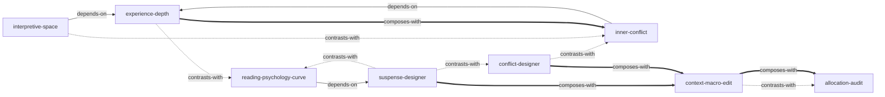

# 《情节：通过人物、悬念与冲突赋予故事生命力》— Skill Index

> 本书由 cangjie-skill 蒸馏，共产出 **8** 个 skills。
> 处理时间: 2026-07-31 · 源文本 112827 字 · 候选池 121 条

## 关于这本书

- **作者**: (美) 诺亚·卢克曼 (Noah Lukeman) — 文学经纪人，5 年读 5000 部原稿
- **出版年**: 2002
- **一句话主旨**: 好的情节不是灵光一现的伟大创意，而是人物+经历+悬念+冲突+上下文五要素的有机集合体。
- **整书理解**: [BOOK_OVERVIEW.md](./BOOK_OVERVIEW.md)
- **术语词典**: [GLOSSARY.md](./GLOSSARY.md)
- **精华长文**（不读全书看这篇）: DIGEST.md（阶段 5 产出）

> **使用调子 ★**: 本套 skill **纯蒸馏**卢克曼原书方法论（2002 文学经纪人视角）。每个 skill 的 B 段诚实标注"文学性 vs 网文爽感"张力，但**不内置网文适配**。网文场景的卢克曼技法翻译由项目现有 `plot-methodology` skill 承接，两者互补不重叠。

---

## Skill 列表（按原书结构分组）

### 经历层（情节引擎）
- [`experience-depth`](./experience-depth/SKILL.md) — 诊断人物弧线"真变"还是"表面变"（深度三层 vs 表面七类）

### 质地层（悬念与冲突）
- [`suspense-designer`](./suspense-designer/SKILL.md) — 给场景注入张力（12 式 + 延长论）
- [`conflict-designer`](./conflict-designer/SKILL.md) — 为人物设计对抗（13 式）
- [`inner-conflict`](./inner-conflict/SKILL.md) — 制造最深刻的内心张力（投射论 + 知行矛盾）

### 整体层（宏观审视）
- [`context-macro-edit`](./context-macro-edit/SKILL.md) — 俯瞰编辑（重复/节奏/移植）
- [`allocation-audit`](./allocation-audit/SKILL.md) — 用篇幅反推真实主题

### 读者层与升华
- [`reading-psychology-curve`](./reading-psychology-curve/SKILL.md) — 诊断受众投入层级（好奇→兴趣→需要→行动）
- [`interpretive-space`](./interpretive-space/SKILL.md) — 设计经久不衰的解读空间（多面性+多维化）

---

## 引用图

图例: `-->` depends-on · `-.->` contrasts-with · `===>` composes-with

---

## 推荐学习顺序

1. **experience-depth** — 基础。人物变化是情节引擎，理解"深度三层"是其他所有 skill 的前提。
2. **suspense-designer** + **conflict-designer** — 并列。质地肌理，分别处理"预期"与"对抗"。
3. **inner-conflict** — 依赖 experience-depth。深入内心层（投射论 + 知行矛盾）。
4. **allocation-audit** → **context-macro-edit** — 整体审视。先诊断篇幅，再宏观修复。
5. **reading-psychology-curve** — 受众层诊断标尺（依赖 suspense 的"未解问题"概念）。
6. **interpretive-space** — 升华，依赖 experience-depth。文学性目标，按需启用。

---

## 审计轨迹

- 候选单元池: [candidates/](./candidates/)（frameworks16 / principles30 / cases42 / counter-examples18 / glossary15 = 121 条）
- 通过三重验证的 8 单元: [verified.md](./verified.md)
- 被淘汰的候选（含原因）: [rejected/REJECTED.md](./rejected/REJECTED.md)
- 整书理解: [BOOK_OVERVIEW.md](./BOOK_OVERVIEW.md)
- 流水线状态: [PIPELINE_STATE.md](./PIPELINE_STATE.md)

---

## 安装使用

本目录是构建产物，宿主不从这里加载 skill。阶段 5 会把通过测试的 skill 安装到项目 `.agents/skills/`（+ `.claude/skills/` 软链）——**不是全局** `~/.claude/skills/`（用户指定）。

## 接入 darwin-skill

所有 skill 带 `test-prompts.json`（darwin 兼容格式，阶段 4 产出），可接入自动进化。
